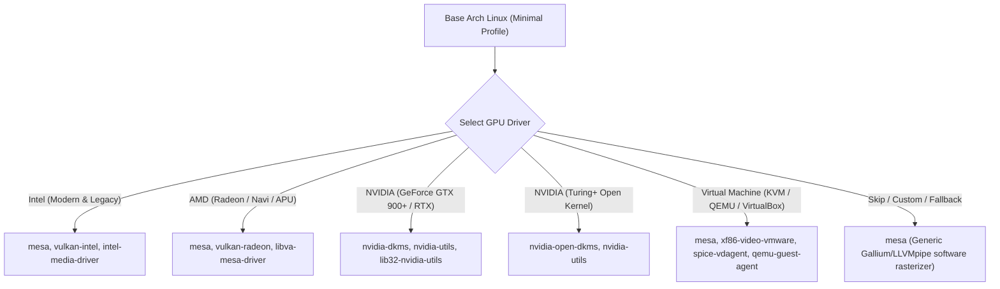
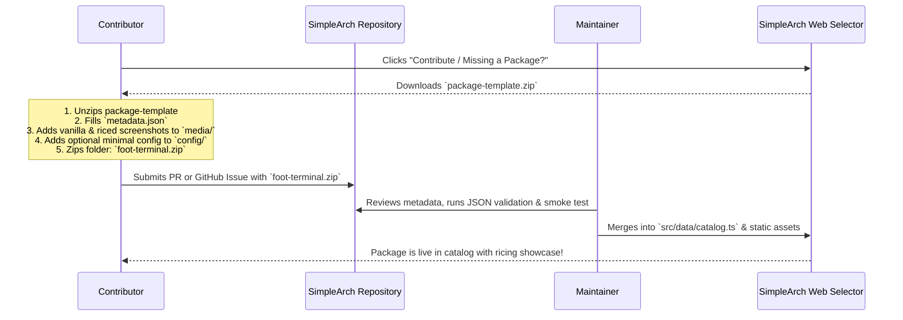

# SimpleArch — Comprehensive Project Context, Technical Findings & Wireframe Analysis

> **Sources:**
> - Conversations: `Simplearch project` (`48072155-...`) and `Simplearch: pre-configured Arch for new users` (`ed61ccb8-...`)
> - Project Docs: [simplearch_v6.md](file:///home/test/Projects/simplearch/docs/simplearch_v6.md), [simplearch_package_research.md](file:///home/test/Projects/simplearch/docs/simplearch_package_research.md), [catalog.ts](file:///home/test/Projects/simplearch/src/data/catalog.ts), [review.md](file:///home/test/Projects/simplearch/review.md)
> - Obsidian Vault: [archinstall_guide_for_simplearch_website.md](file:///home/test/Documents/Obsidian%20Vault/archinstall_guide_for_simplearch_website.md), [archinstall-selections.md](file:///home/test/Documents/Obsidian%20Vault/archinstall-selections.md), [simple arch.md](file:///home/test/Documents/Obsidian%20Vault/simple%20arch.md)
> - Visual Reference: [wireframe.png](file:///home/test/wireframe.png)
> **Last Updated:** September 2026

---

## 1. Executive Summary & Core Philosophy

### What is SimpleArch?
**SimpleArch** is a dual-layer platform for Arch Linux consisting of:
1. **An Interactive Pre-Install Guide:** Visual, opinionated step-by-step guidance through official `archinstall` to establish a rock-solid, predictable foundation.
2. **A Post-Install Selection Wizard:** An à la carte web catalog that exposes the complete selection surface of a daily-driver Arch workstation, generating a single, safe post-install shell script that automates package installation and pulls working baseline configurations.

### Core Guiding Axiom
> *"Skip the weeks of research into what tools exist and what is good, without skipping the configuration step (which ricers actually enjoy)."*

Unlike opinionated distributions (like Omarchy) that lock users into a single pre-configured desktop, SimpleArch provides **the entire palette of vetted components** while guaranteeing that whatever combination the user picks results in a booting, usable system.

---

## 2. Identified Conflicts & Critical Architectural Decisions

Reviewing the historical files alongside the latest design in `wireframe.png` reveals several important evolutionary shifts and conflicts that have now been resolved:

| Area | Earlier Spec / Initial Notes | Latest Decision / Wireframe State | Resolution & Impact |
| :--- | :--- | :--- | :--- |
| **Unified Kernel Images (UKI)** | `archinstall-selections.md` marked UKI as **Enabled**. | `wireframe.png` callout explicitly states: *"Keep Unified Kernel Image disabled for now."* | **Resolved:** UKIs bundle kernel + cmdline + initramfs into a single signed EFI executable. This breaks `limine-snapper-sync` dynamic boot entries (which inject `rootflags=subvol=<snapshot>` into the kernel cmdline). UKI must stay **disabled** when using snapshot rollbacks. |
| **Archinstall Profile** | `archinstall-selections.md` tested `Desktop -> Hyprland`. | `simplearch_v6.md`, Obsidian guide, and latest chat strictly prescribe **`Minimal`**. | **Resolved:** Selecting `Desktop` pre-installs conflicting bundles and skips custom driver setup. `Minimal` provides a pure, clean canvas for SimpleArch's script. |
| **Config Repository Sourcing** | `simplearch_v6.md` and `catalog.ts` used individual `default_config_repo` URLs per package. | Chat decision: Single centralized GitHub dotfiles repo maintained by Haw. | **Resolved:** Managing dozens of third-party git repos causes drift and broken configs. Haw maintains a single repo of modular baseline configs (one folder per component) with a single root `README.md`. |
| **XWayland Positioning** | `package_research.md` listed XWayland as an independent top-level protocol choice. | `review.md` note: *"Xwayland should be under wayland and they will be bundled as one."* | **Resolved:** Users picking Wayland automatically receive XWayland compatibility without an extra gating question. |
| **Live Scanning vs. Self-Report** | v5 spec used Rust/ratatui with live machine inspection. | v6 uses a two-visit stateless website + post-install script. | **Resolved:** Browser cannot scan local hardware; script handles local safety nets (`.bak1`, `.bak2` backups) and pacman collision detection. |

---

## 3. Analysis of the Wireframe (`~/wireframe.png`)

The wireframe represents the **Archinstall Pre-Step Guide** (specifically the `Bootloader` step). It establishes a clean, editorial, non-generic design language:

```
+-----------------------------------------------------------------------------------------+
| [ SimpleArch ]                                                    Guide  Selector  GitHub|
+-----------------------------------------------------------------------------------------+
| Guide > Bootloader                                                                      |
| [===] [===] [===] [███] [   ] [   ] [   ] [   ] (8-step progress tracker)               |
|                                                                                         |
| # Bootloader                                                                            |
| Choosing between GRUB and Limine, and configuring Plymouth + UKI options.               |
|                                                                                         |
| +-----------------------------------------------+ +-----------------------------------+ |
| | GRUB vs Limine                                | | [ screenshot: bootloader menu ]   | |
| | Body paragraph explaining Limine + Snapper... | |                                   | |
| +-----------------------------------------------+ +-----------------------------------+ |
|                                                                                         |
| +-----------------------------------------------+ +-----------------------------------+ |
| | [ GIF: Plymouth boot splash, details mode ]   | | Plymouth: Details Mode            | |
| |                                               | | Body paragraph explaining mode... | |
| +-----------------------------------------------+ +-----------------------------------+ |
|                                                                                         |
| ⚠ [ Callout: "Keep Unified Kernel Image disabled for now, see why below." ]             |
|                                                                                         |
| ### Vanilla vs Configured — Example                                                     |
| +-----------------------------------+   +---------------------------------------------+ |
| | [ screenshot: default/unconfig ]  |   | [ screenshot/gif: usability config applied ]| |
| | Before (vanilla default)          |   | After (SimpleArch minimal config)           | |
| +-----------------------------------+   +---------------------------------------------+ |
|                                                                                         |
| [ ← Back: Swap ]                                                      [ Next: Kernel → ]|
+-----------------------------------------------------------------------------------------+
```

### Key UI/UX Characteristics from the Wireframe:
1. **Utility-Focused Navigation:** Clean brand mark, top-right mode switches (`Guide`, `Selector`, `GitHub`), and breadcrumbs with an 8-segment progress tracker.
2. **Alternating Visual Rows:** Row 1 has text on the left and a screenshot on the right; Row 2 alternates with media on the left and text on the right. This keeps long technical instructions visually dynamic and prevents reading fatigue.
3. **Dedicated Alert Callouts:** Prominent callout banners for critical warnings (e.g. UKI snapshot incompatibility) before the user makes an irreversible install choice.
4. **"Vanilla vs Configured" Comparison Engine:** Every step demonstrates what the component looks like out of the box versus what it looks like with SimpleArch's minimal usability config applied.
5. **Linear Step Flow:** Explicit, high-contrast bottom navigation (`Back: [Step]` / `Next: [Step]`).

---

## 4. The 8 Guide Steps (The Standard Archinstall Baseline)

Based on the wireframe progress bar and `archinstall-selections.md`, the 8 sequential guide steps are:

1. **Locales & Mirrors:** `en_US.UTF-8`, closest regional mirrors, `core` + `extra` + `multilib` (required for Steam/Wine/32-bit).
2. **Disk Partitioning & Btrfs:** Best-effort Btrfs subvolumes (`@`, `@home`, `@var_log`, `@var_cache`, `@snapshots`). `@home` as a subvolume ensures user data survives OS reinstallations. Compression set to `zstd`.
3. **Disk Encryption:** LUKS on system partition (ESP left unencrypted for EFI firmware). Iteration time 10000ms (5000ms in VM testing). HSM/FIDO2 documented as optional.
4. **Snapshots & Swap:** Snapper on root (`@`) only (excluding `@home` to avoid rolling back user files); zram swap with `zstd` (or `lz4` on ancient CPUs).
5. **Bootloader:** **Limine** (for native `limine-snapper-sync` rollback support), **Plymouth** in `details` mode (or omitted on legacy hardware), **UKI disabled**.
6. **Kernels:** Multi-kernel strategy: `linux` + `linux-lts` (fallback), or `linux-zen` + `linux-lts` (gaming). Surface devices add `linux-surface`.
7. **Authentication & Network:** Root login disabled (blank password), primary user in `sudo`/`wheel`. NetworkManager with `iwd` backend for modern Wi-Fi (Intel 8265/8275), or default backend for legacy/Realtek.
8. **Applications & Profile:** Profile set to **`Minimal`**; Audio set to **PipeWire**; Firewall set to **UFW**; Bluetooth and CUPS enabled.

---

## 5. The Hardware Profiles (Modern vs. Ancient)

SimpleArch accounts for hardware constraints through explicit presets:

| Component | Standard Modern Hardware (e.g. HP EliteDesk 800 G3) | Legacy / Ancient Hardware (e.g. Pentium E5800, old iGPU) |
| :--- | :--- | :--- |
| **Compositor / WM** | Hyprland (Wayland, GPU-composited, blur, animations) | **XFCE / LXQt** (X11 DE) or **i3 / bspwm** (X11 tiling) |
| **Display Protocol** | Wayland (+ XWayland) | **Pure X11 (Xorg)** |
| **Greeter** | **SDDM** (Wayland-native, multi-session support) | **ly** (TUI greeter, zero GPU overhead) |
| **Boot Splash** | Plymouth (`details` theme for initial boot diagnostics) | **No Plymouth** (avoids black screen on legacy GMA chipsets) |
| **Swap Compression** | **zstd** (optimal compression ratio) | **lz4** (lowest CPU cycles on weak dual-cores) |
| **Wi-Fi Backend** | `iwd` (efficient crypto offload for Intel chips) | `wpa_supplicant` (universal compatibility) |

---

## 6. The Post-Install Execution Architecture

### 1. Hardware Driver Detection & Resolution
Because `archinstall` Minimal does not install GPU drivers, SimpleArch's script detects the GPU and installs the complete graphic stack:
* **Intel:** `mesa`, `vulkan-intel`, `intel-media-driver`
* **AMD:** `mesa`, `vulkan-radeon`, `libva-mesa-driver`
* **NVIDIA:** `nvidia-dkms` (or open-kernel), `nvidia-utils`, environment variables (`LIBVA_DRIVER_NAME=nvidia`, etc.)
* **VMs / QEMU:** `spice-vdagent`, `qemu-guest-agent`, VirtIO graphics

### 2. Custom Repositories (Opt-In)
* **Chaotic-AUR:** Pre-compiled AUR packages to eliminate compile-time bottlenecks on lower-spec CPUs.
* **CachyOS Repos:** CPU-microarchitecture-optimized packages (x86-64-v3/v4) for gaming and responsiveness.

### 3. Non-Destructive Backup Routine
* Overwritten configs are backed up with incrementing extensions: `.bak1`, `.bak2`, `.bak3`.
* Script concludes with an end-of-run summary table displaying every altered file and its backup path.

### 4. Usability Floor & First-Boot Onboarding
* Minimal, working configs are fetched from Haw's GitHub dotfiles repository.
* On first graphical boot, an autostart floating cheat-sheet (or temporary wallpaper) displays essential navigation keybindings (Terminal, Launcher, Browser, Close, Logout) along with instructions to dismiss it.

---

## 7. The Four Operational Installation Modes

SimpleArch supports four distinct operational modes to match different user entry points and hardware constraints:

| Mode # | Mode Name | archinstall Baseline | Target Hardware | Rationale & Tradeoffs | Recommendation Status |
| :--- | :--- | :--- | :--- | :--- | :--- |
| **Mode 1** | **Desktop Post-Install** | Profile: `Desktop` (e.g. GNOME, KDE, or Hyprland) | Modern / Standard | User already ran archinstall with a full desktop. SimpleArch skips base graphics and only installs complementary utilities, launchers, and ricing enhancements. | Supported (for existing setups) |
| **Mode 2** | **Minimal Base + SimpleArch** | Profile: **`Minimal`** | Modern / Standard | Pure, clean canvas. SimpleArch controls the full graphics driver stack, compositor, modular shell daemons, and dotfiles with zero package collisions. | **⭐ Highly Recommended** |
| **Mode 3** | **Replace Existing Profile** | Profile: Any previous DE/WM | Modern / Standard | User selected a DE during archinstall but regrets it. Script removes conflicting display managers/services and replaces them with the SimpleArch stack. | ⚠️ Not Recommended (risk of leftover orphan configs) |
| **Mode 4** | **Ancient Hardware Mode** | Profile: **`Minimal`** | Legacy (Core2Duo, non-Vulkan iGPU, ≤4GB RAM) | Enforces pure X11 protocol, lightweight window managers (i3, bspwm) or DEs (XFCE, LXQt), `lz4` zram swap, disables Plymouth bootsplash, and avoids GPU compositing. | **Specialized (Legacy Savior)** |

---

## 8. GPU Driver Matrix & Installation Logic

Because Mode 2 and Mode 4 prescribe `archinstall`'s **Minimal** profile, the base installation has **zero display drivers**. The SimpleArch generator includes an explicit Hardware Driver selector with the following package resolution:



### NVIDIA Special Post-Processing
For NVIDIA users on Wayland compositors (Hyprland/Sway), the generated script automatically injects the required environment variables into `/etc/environment` or wrapper scripts:
```bash
LIBVA_DRIVER_NAME=nvidia
GBM_BACKEND=nvidia-drm
__GLX_VENDOR_LIBRARY_NAME=nvidia
NVD_BACKEND=direct
```

---

## 9. Contributor Package Submission System

To prevent SimpleArch from becoming a bottleneck where only maintainers can add new software, a decentralized, low-friction contributor model is implemented:

### Contributor Workflow via ZIP Submission


### Standardized `metadata.json` Schema
Each contributed package contains:
- **Identification:** `name`, `category`, `type`, `protocol` (`wayland` / `x11` / `agnostic`), `source` (`repo` / `aur`).
- **Package Manifest:** Array of exact pacman/AUR packages.
- **Hardware & Stability:** `stability_score` (1-10), `tags` (`verified`, `old-hardware-friendly`, `minimal-memory`, `gpu-composited`), and hardware flags.
- **Objective Evaluation:** `pros` (2-4 items) and `cons` (1-3 items) to prevent marketing bias.
- **Compatibility Map:** Supported protocols, conflicting packages, and curated companion pairings.
- **Visual Ricing Showcase:** Before-ricing screenshot (`media/vanilla.png`) and one or more after-ricing screenshots/GIFs/videos with titles and descriptions.

---

## 10. Client-Side Script Generator Architecture & Headless Delivery

### Static Zero-Backend Guarantee
The SimpleArch selector is hosted on GitHub Pages as a static web application. It runs 100% in the user's browser, compiling the chosen configuration into a self-contained POSIX shell script without requiring server-side rendering or databases.

### Execution Sequencing Pipeline
The generated shell script adheres to strict execution phases:

1. **Phase 1: Environment & Sanity Checks**
   - Verify non-root execution (with `sudo` privileges).
   - Test active internet connection (`ping -c 1 archlinux.org`).
   - Create non-destructive backup directory: `~/.config/simplearch_backups/run_$(date +%s)`.
2. **Phase 2: Graphics Drivers & Display Protocol**
   - Install selected GPU drivers (`mesa`, `vulkan-intel`, `vulkan-radeon`, or `nvidia-dkms`).
   - Set protocol-specific environment variables.
3. **Phase 3: Package Manager Bootstrapping**
   - Update pacman mirrors and enable parallel downloads (`ParallelDownloads = 5`).
   - If AUR packages are selected, bootstrap AUR helper (`paru-bin` or `yay-bin`) safely using `git clone` into a temporary directory and `makepkg -si`.
4. **Phase 4: Official Repository Installation**
   - Install all selected official repo packages in a single atomic `pacman -S --needed --noconfirm` command.
5. **Phase 5: AUR Package Installation**
   - Install all selected AUR packages via the bootstrapped helper.
6. **Phase 6: Config Layering & Non-Destructive Backup**
   - Fetch modular baseline configurations from Haw's centralized GitHub repository.
   - For any existing configuration file in `~/.config/`, move to `.bak1`, `.bak2`, etc.
7. **Phase 7: Systemd User & System Services**
   - Enable network, display manager (e.g. `sddm.service`), and user-level audio daemons (`pipewire`, `wireplumber`).
8. **Phase 8: First-Boot Onboarding & Summary Table**
   - Generate navigation cheat-sheet popup script for first graphical login.
   - Print comprehensive summary table of all installed packages, backup paths, and reboot instruction.

### Headless Delivery (Browser to Bare Arch TTY)
Because a user who just finished `archinstall` has only a bare console (no web browser installed yet), the script delivery supports three complementary methods:

1. **Ephemeral Zero-Account Paste (Default):**
   - Web browser performs a direct client-side `fetch` POST to a privacy-friendly, zero-login paste endpoint (e.g., `dpaste.org` or `paste.rs`).
   - User receives a short, human-typeable URL to run directly in the bare TTY:
     ```bash
     curl -sL https://dpaste.org/xyz1/raw | bash
     ```
2. **Direct Download (`simplearch-install.sh`):**
   - For users generating the script on a secondary PC or saving to a USB flash drive:
     ```bash
     bash /path/to/simplearch-install.sh
     ```
3. **Clipboard Copy:**
   - Instant copy for users already inside a running terminal (e.g., in a VM or SSH session).

---

## 11. Local Virtual Machine Testing Framework (`~/arch-vm/`) & QEMU Troubleshooting

To rigorously test `archinstall` flows and generated bash scripts before running them on physical hardware, a dedicated QEMU virtual environment was established in `~/arch-vm/`:

### Environment Layout:
* **Directory:** [`~/arch-vm/`](file:///home/test/arch-vm/)
* **Virtual Disk:** `arch-disk.qcow2` (20 GB dynamic sparse qcow2 image).
* **Base ISO:** `archlinux-latest.iso` (1.5 GB official Arch Linux ISO, cached locally).
* **Launch Script:** [`~/arch-vm/start-vm.sh`](file:///home/test/arch-vm/start-vm.sh).
* **Resource Profile:** 2 vCPUs and 2048 MB RAM (tailored to keep host resources responsive on 4-core, 8GB machines).
* **Networking:** User-mode NAT with SSH port-forwarding (`localhost:2222 -> guest:22`).

### Technical Discovery: The QEMU Black-Screen Resolution
During early testing, launching QEMU with UEFI firmware presented an apparent "black screen" or silent boot hang. In-depth tracing revealed the dual root causes:
1. **Missing Writable NVRAM Flash:** OVMF firmware requires both `OVMF_CODE` and a writable `OVMF_VARS` drive. Running with read-only code without a local variable file caused firmware initialization stalls.
2. **Legacy IDE Emulation on Default Machine Type:** Defaulting to `pc` (`i440fx`) paired with `-cdrom` emulated a 1990s PIIX4 IDE bus, causing high latency during large `initramfs` decompression (245MB compressed). Furthermore, systemd-boot defaulted to an unrendered 15-second countdown on 1280x800 frames.

**Resolution in `start-vm.sh`:**
- **Primary / Default Mode (Standard BIOS):** Boots `ISOLINUX` **instantly in <1 second** with zero bootloader stall.
- **UEFI Mode (`./start-vm.sh --uefi`):** Utilizes `-machine q35` (modern PCIe/AHCI bus) with a local writable NVRAM file (`arch-vars.fd`) and `-vga virtio` display adapter.

---

## 12. Developer Operations & CLI Management

### The `simplearch` Global Runner
A convenience script exists at [`~/Projects/simplearch/run.sh`](file:///home/test/Projects/simplearch/run.sh) and is symlinked to `~/.local/bin/simplearch` (in `$PATH`):
- `simplearch`: Checks if port 3000 is listening; if down, starts the Next.js server in the background and launches `omarchy-launch-browser` or `xdg-open`.
- `simplearch --status`: Prints health status, URL, and PID.
- `simplearch --stop`: Cleanly terminates the background web server.
- `simplearch --logs`: Live-tails `.site.log`.

### Note on Container / Host Restarts
Host restarts and container restarts terminate background processes. When reviving work, running `simplearch` or `npm run dev -- --hostname 0.0.0.0 --port 3000` re-binds the web selector immediately.

